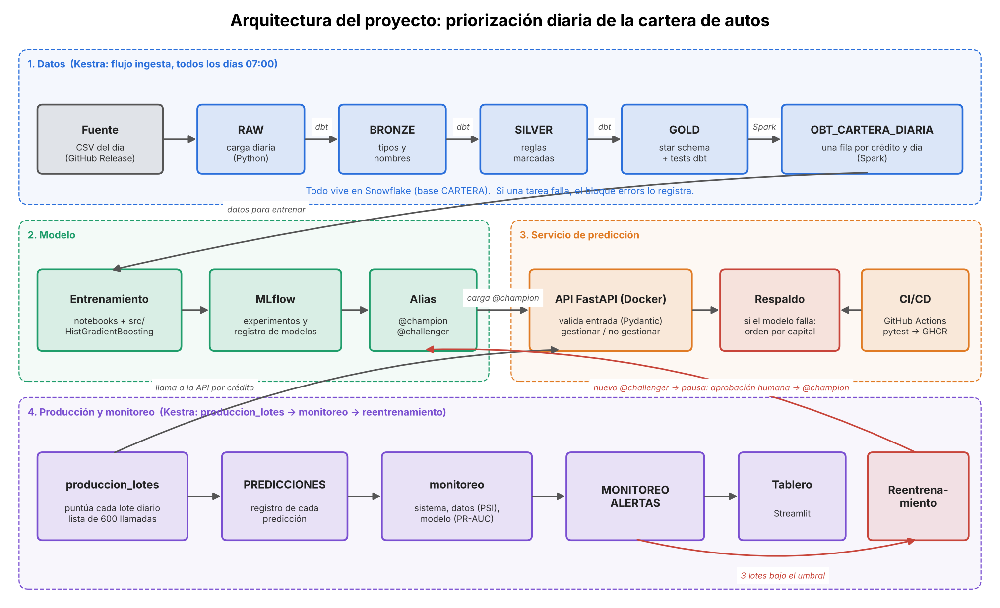

# Proyecto final: priorización de cartera en cobranzas

Ciencia de Datos · Maestría en Ciencia de Datos (USFQ) · PSets #1 a #4 · Stephania Cárdenas Jácome

> **Datos:** anonimizados y sintéticos. No contienen información real de clientes.

## El problema

Cada día el call center tiene capacidad para **600 llamadas** (10 cobradores × 60). La regla actual ordena la cartera vencida de autos por capital insoluto. El proyecto reemplaza esa regla por un modelo que estima la **probabilidad de que el crédito pague en los próximos 7 días** y ordena por **probabilidad × capital insoluto** (monto esperado a recuperar).

En la simulación de 18 lotes diarios (octubre 2026), la lista del modelo capturó **2 651 pagos frente a 1 745 de la regla actual (+52 %)**.



## Estructura

| Carpeta | Contenido |
|---|---|
| `snowflake/` | `setup.sql`: bodega, base `CARTERA`, capas, rol, usuario de servicio y esquema `PRODUCCION`. |
| `ingesta/` | Carga diaria de la fuente a la capa RAW. |
| `dbt/` | Modelos Bronze → Silver → Gold (esquema estrella) y pruebas de calidad. |
| `spark/` | `job_obt.py`: construye `GOLD.OBT_CARTERA_DIARIA`. |
| `calidad/` | Diagnóstico de calidad de datos. |
| `notebooks/` | 01–05: EDA, features, modelos, tuning y selección. 06: simulación de producción. 07: análisis del monitoreo. |
| `src/` | Código reutilizable: pipeline de features, nota de corte, lotes, producción y reentrenamiento. |
| `api/` | Servicio de predicción (FastAPI + Docker). |
| `tests/` | Pruebas de contrato, modelo y comportamiento (pytest). |
| `monitoreo/` | Deriva (PSI, KS, chi²), alertas y tablero (Streamlit). |
| `kestra/` | Flujos: `ingesta`, `produccion_lotes`, `monitoreo`, `reentrenamiento`. |
| `herramientas/` | Imágenes Docker de dbt/Spark (`pset2-tools`) y de Python/ML (`proyecto-ml`). |
| `docs/` | Diagramas, registro de cambios, figuras, exportaciones CSV y memos anteriores (`historial/`). |
| `../.github/workflows/` | CI (`ci.yml`) y CD (`cd.yml`). Van en la raíz porque GitHub Actions solo los lee ahí. |

## Requisitos

- Docker y Docker Compose (probado en GitHub Codespaces: 2 CPU, 8 GB de RAM, 32 GB de disco).
- Python 3.12 y [uv](https://docs.astral.sh/uv/).
- Una cuenta de Snowflake con permisos de `ACCOUNTADMIN` para la preparación inicial.

## Reproducción desde cero

### 1. Snowflake (una sola vez)

1. En Snowflake, abrir un Worksheet, pegar `snowflake/setup.sql`, seleccionar todo y ejecutar.
2. Generar el token (PAT) del usuario `PSET2_SERVICE` como indica el paso 4 del script.

### 2. Variables de entorno

```bash
cd proyecto_final
cp .env.example .env
```

Llenar `.env` con la cuenta de Snowflake, el token y la clave de Kestra. La clave de Kestra debe tener al menos 8 caracteres, una mayúscula y un número. **El `.env` nunca se sube a GitHub** (está en `.gitignore`).

### 3. Entorno de Python

```bash
uv venv
source .venv/bin/activate
uv pip install -r requirements.txt
```

### 4. Construir imágenes y levantar los servicios

```bash
docker compose --profile herramientas build
docker compose build
docker compose up -d
```

| Servicio | Puerto | Para qué |
|---|---|---|
| Kestra | 8080 | Orquestación de todos los flujos. |
| MLflow | 5000 | Experimentos y registro de modelos. |
| API | 8000 | Predicción (`/salud`, `/modelo`, `/predecir`, documentación en `/docs`). |
| Tablero | 8501 | Monitoreo en producción. |

### 5. Datos: fuente → Raw → Bronze → Silver → Gold → OBT

1. En Kestra (puerto 8080): **Flows → Create**, pegar `kestra/ingesta.yml` y guardar.
2. Para cargar todo octubre: pestaña **Triggers** del flujo → **Backfill** del 2026-10-01 al 2026-10-31. Para un solo día: **Execute** con la fecha.
3. Cada ejecución corre `cargar_raw` → `construir_gold_dbt` (`dbt build`, con pruebas) → `construir_obt_spark`. Después de eso, el flujo corre solo todos los días a las 07:00 (hora de Ecuador).

### 6. Modelo

Ejecutar en orden `notebooks/01_eda.ipynb` a `05_seleccion.ipynb`. El notebook 05 registra el modelo `priorizacion-cartera-modelo` en MLflow con el alias `@champion`. Después:

```bash
python src/nota_corte.py
```

Guarda en la versión `@champion` la **nota de corte**: el puntaje del crédito número 600 en promedio de los días de entrenamiento. La API la usa para decidir *gestionar / no gestionar*.

### 7. API y pruebas

```bash
docker compose up -d --force-recreate api
curl -s localhost:8000/modelo
python -m pytest tests -q
```

Cada `push` corre el CI (pruebas + construcción de la imagen). Si pasa en `main`, el CD publica la imagen en GHCR como `ghcr.io/stephania99c/pset4-api:<sha del commit>`.

- **Rollback:** mover el alias `@champion` a la versión anterior en MLflow (**Models → priorizacion-cartera-modelo → Aliases**). La API detecta el cambio en la siguiente predicción, sin reiniciar.
- **Interruptor de respaldo:** `MODO_RESPALDO=true docker compose up -d api`. La API deja de usar el modelo y ordena por capital insoluto (regla actual). Para volver: `docker compose up -d api`.

### 8. Simulación de producción, monitoreo y reentrenamiento

1. Ejecutar `notebooks/06_simulacion_produccion.ipynb`. Crea en `CARTERA.PRODUCCION` las tablas `REFERENCIA` (1–13 de octubre) y `LOTES` (14–31 de octubre). A partir del 18 de octubre induce deriva: `dias_mora` desordenado y +90 días, simulando un error de integración.
2. En Kestra, crear los flujos `reentrenamiento.yml`, `monitoreo.yml` y `produccion_lotes.yml`, en ese orden, porque cada uno llama al anterior.
3. Ejecutar `produccion_lotes`. Por cada lote: puntúa con la API → guarda en `PREDICCIONES` → `monitoreo` calcula métricas y alertas (`MONITOREO`, `ALERTAS`) → si el PR-AUC está bajo 0.415 en 3 lotes evaluados seguidos, `reentrenamiento` entrena un challenger y **se pausa** esperando aprobación humana.
4. Para aprobar: en la ejecución pausada, **Resume** → `aprobar = true` y un comentario. El alias `@champion` pasa al nuevo modelo.
5. Revisar el tablero (puerto 8501) y ejecutar `notebooks/07_analisis_monitoreo.ipynb`, que genera las figuras y exporta a `docs/`: `corridas.csv`, `predicciones.csv`, `monitoreo.csv`, `alertas.csv` y `reentrenamientos.csv`.

## Reglas de decisión

| Regla | Valor |
|---|---|
| Decisión de la API | Gestionar si puntaje ≥ nota de corte de la versión. |
| Respaldo | Gestionar si capital insoluto ≥ 18 399.41 (regla actual). |
| Promoción de un challenger | Sobre el mismo lote etiquetado más reciente: captura más pagos en la lista de 600 **y** su PR-AUC supera al champion por más de 0.022, **y** aprobación humana. |
| Deriva de datos | PSI ≥ 0.10 media, ≥ 0.25 alta (`dias_mora` por tramos de negocio). KS y chi² como respaldo. Solo alerta, no reentrena. |
| Reentrenamiento | PR-AUC < 0.415 en 3 lotes evaluados seguidos. |
| Sistema | Errores > 5 % o latencia p95 > 1 000 ms. |

## Notas de operación

- **Memoria:** Kestra está limitado a 1.5 GB (`JAVA_OPTS`) y se reinicia solo si se cae. Para correr la ingesta con Spark conviene apagar el tablero y la API: `docker compose stop tablero api`.
- **Disco:** la imagen de Kestra ocupa unos 10 GB. Si el disco se llena: `docker builder prune -af`.
- **Kestra 2.0:** los flujos usan la sintaxis de Kestra 2.0 (`Loop` en lugar de `ForEach`, configuración en cada tarea en lugar de `pluginDefaults`).
- Los cambios respecto a los PSets anteriores están en `docs/cambios.md`.
