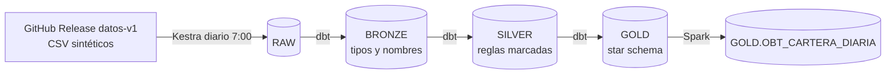
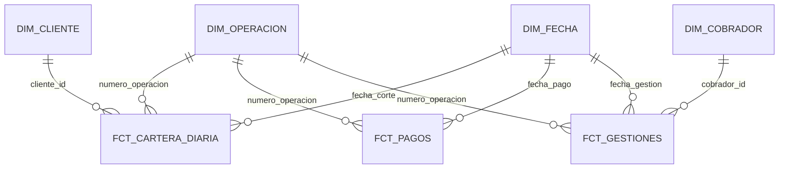
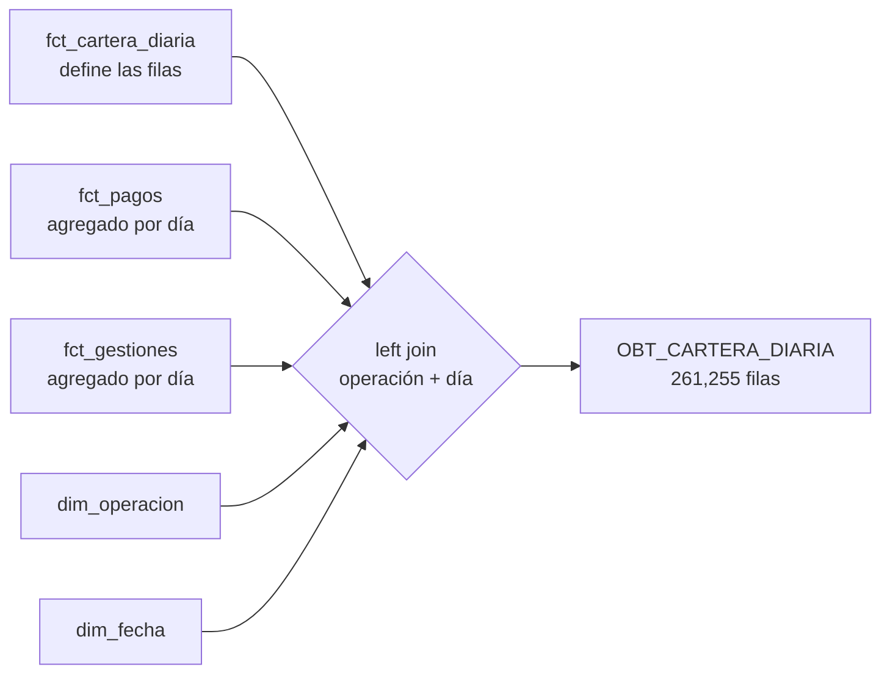

# Diagramas

## Arquitectura

## Star schema (Gold)

| Tabla | Grano |
|---|---|
| fct_cartera_diaria | una operación de auto (pagaré PRINCIPAL) por día de corte |
| fct_pagos | un pago aplicado de recaudación |
| fct_gestiones | una gestión de call center (sin duplicados) |
| dim_operacion | una operación de auto |
| dim_cliente | un cliente |
| dim_cobrador | un gestor de call center |
| dim_fecha | un día |

## OBT

